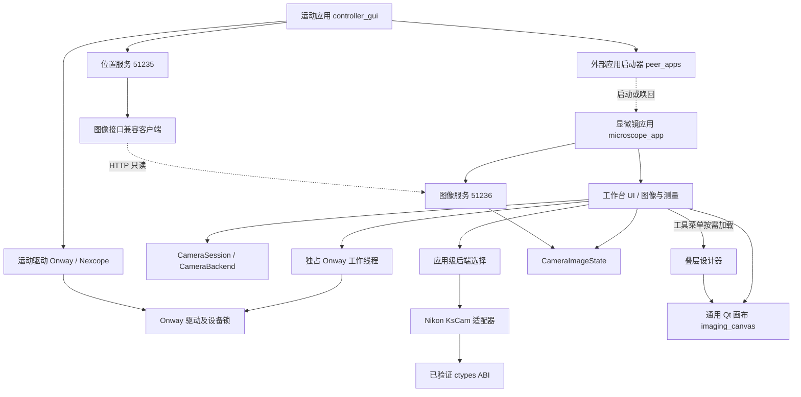

# 应用边界与演进原则

更新：2026-11-11。显微镜工作台是独立应用，与运动控制程序并列。`motion-control` 目前只是存放多个应用源码的仓库目录；不代表显微镜归运动程序管理。显微镜未来成为主要工作入口时，也不应通过嵌入其他程序窗口来组织设备控制。随后按用户要求，将叠层设计器迁为显微镜内部的按需加载工具；运动程序不再提供或管理它。

## 本次梳理发现及调整

| 原耦合 | 现有边界 |
|---|---|
| 运动程序创建 `MicroscopeWindow(self)`，持有其对象，并在自身退出时关闭它 | 菜单调用 `peer_apps.launch_microscope()` 启动脱离父进程生命周期的应用；不导入窗口、不持有窗口、不等待或停止相机 |
| 显微镜启动时从 `stack_designer` 导入画布和多边形，连带加载 OpenCV、选区处理 | 通用控件抽到 `imaging_canvas.py`；相机/测量核心不依赖设计器。只有点击“工具 → 异质结叠层设计…”时，才加载设计器及 OpenCV |
| 显微镜设置属于 `%APPDATA%/motion-control/` | 独立 `%APPDATA%/microscope-workbench/settings.json`；仅首次兼容读取旧文件，不回写旧文件 |
| 运动程序持有 `CameraImageState` 并发布相机图像 | 图像状态和 HTTP 服务归显微镜；运动程序仅有兼容客户端，转发旧路径 |
| 相机采集核心中选择具体 Nikon 实现，后端又引用核心帧类型 | 后端选择移到 `microscope_backends.py`；采集核心只依赖注入的工厂和相机接口 |
| 没有可验证的独立分发边界 | `pyproject.toml` 明列显微镜模块，构建独立 wheel；临时目录隔离启动通过 |

## 当前依赖结构

实线代表进程内依赖；虚线代表进程间启动或只读请求。



显微镜窗口强制没有 Qt 父窗口。只有显微镜自身决定何时停止相机、保存设置和退出。单实例锁及本地唤回接口由显微镜拥有；重复点击启动入口只唤回已有实例，不重连相机。唤回接口不能操作硬件。运动程序退出不关闭显微镜，显微镜退出也不关闭运动程序。

`camera_protocol.py`、`snapshot_http.py` 是无 Qt、无驱动的协议/传输模块；`imaging_canvas.py` 只依赖 Qt 和标准库。共享层不得反向导入任何应用入口、窗口、配置管理器或厂商 SDK。

## 应用各自拥有的资源

| 资源 | 显微镜 | 运动控制 |
|---|---|---|
| 入口 | `microscope_app.py`；旧 `microscope_workspace.py` 命令委托给它 | `controller_gui.py` |
| 窗口与生命周期 | 独立进程、独立 QApplication、独立单实例管理 | 自身进程与窗口 |
| 硬件句柄 | CameraSession 中的相机；控制台另有单独工作线程持有显式连接的 Onway | Onway（与显微镜互斥）/ Nexcope |
| 图像状态 | 原始 RGB8、软件白平衡、标记、测量、PNG 快照；叠层设计器拥有自身工程状态 | 不持有相机或设计器对象；请求时通过客户端读取相机图像 |
| 设置 | `%APPDATA%/microscope-workbench/settings.json` | 原有设置继续由运动应用管理 |
| HTTP | `127.0.0.1:51236/api/v1/camera/image` | `127.0.0.1:51235/position`；旧图像路径为兼容转发 |
| Python 依赖 | PyQt6、NumPy；设计器使用 OpenCV；SDK 仅显式连接时加载 | 现有运动程序依赖 |

旧图像地址 `http://127.0.0.1:51235/api/v1/camera/image` 保留 PNG、图像 ID 和内嵌元数据的一致性。相机程序不存在时返回 503，不影响 `/position`。新客户端应直接访问 51236，以便运动程序关闭时仍能读图。退出显微镜会停止其服务器；客户端需处理连接失败。`--no-api` 可禁用服务，`--api-port` 可改变端口；旧兼容转发默认读取 51236。

旧配置迁移只在新配置不存在时执行，沿用完整内容校验。校验失败不会以默认值覆盖旧文件或写出错误的新配置。显式指定测试设置文件时不读取用户旧配置。

## 接下来接入运动控制的原则

2.0 的控制台通过独立工作线程直接使用 Onway 驱动（TCP/IP 或串口）。两个 2.0 应用通过同一用户下的设备锁仲裁连接；显微镜不导入运动程序窗口或 Nexcope 驱动。接口及操作说明见 README。

1. 先定义与 GUI 无关的运动接口：连接状态、坐标/单位、移动、停止、完成状态和错误。显微镜的按钮调用这个接口，不能调用 `MCCMainWindow` 或 `NexcopeControlPage` 的方法。
2. 同一设备连接只由一个执行方持有。若运动程序继续持有连接，显微镜经显式命令协议请求它；若以后显微镜直接控制设备，则将纯驱动接入它自己的工作线程，运动程序同时访问时必须有明确的互斥/仲裁。两个界面不可分别写同一串口。
3. Onway 驱动随两个应用分别分发；二者均未新增运动命令 HTTP API。
4. 扫描、自动对焦等流程应在显微镜的任务编排层组合相机接口与运动接口，显式处理完成、超时、取消和停止。HTTP 请求线程不能直接操作 SDK 或运动驱动。
5. 图像与位置需要同步时，定义同一采集任务中的帧、位置、时间和标定信息；现有两个“最新值”接口不保证同步，不能拼接后声称是曝光时的位置。
6. 哪个程序是用户主要入口只影响导航与工作流，不改变模块依赖方向。未来显微镜可以启动运动工具，但不持有其窗口、设备句柄或退出生命周期。

叠层设计器现已迁到显微镜的“工具 → 异质结叠层设计…”。它作为显微镜工具窗口按需创建，同一会话内重复打开复用原设计；退出显微镜时等待轮廓处理结束并关闭设计器。截图会隐藏并恢复设计器与显微镜窗口。运动程序已移除其菜单、对象引用和关闭逻辑。设计器不反向导入显微镜窗口或运动程序，仍可用 `python stack_designer.py` 独立运行；原工程格式与导出流程不变。

显微镜的图像处理参数位于“编辑 → 边缘识别参数”子菜单，可直接调整处理分辨率、色差阈值、最小面积和轮廓简化程度。默认最长边 720 px、自动阈值、面积 0.01%、简化 0.4%，支持恢复默认值。参数保存在显微镜配置的 `edge_detection` 字段，旧配置缺失该字段时使用默认值；异常字段沿用完整校验及禁止覆盖原文件的规则。`edge_detection_parameters()` 在 GUI 线程返回独立字典，供后续处理线程接收配置快照；本次只接入菜单与配置，尚未启用实时处理，也不修改设计器工具内的照片参数。相机采集尺寸与这些分析参数相互独立，菜单不加载 OpenCV、SDK 或运动模块。

参数菜单回归：工作台、相机会话、应用边界及叠层设计共 **79 项测试、45 项子测试通过**（两项运动程序兼容测试因沙箱读取权限单独重跑后通过）。另用离屏 Qt 交互验证子菜单路径、下拉选择后菜单保持展开、输入值在菜单关闭时提交、重启恢复及恢复默认值；菜单截图保存在 `docs/edge-parameter-menu/menu-defaults.png`。没有重启用户正在运行的显微镜实例。

## 独立分发与启动

```powershell
# 开发目录中直接启动；无需先运行 motion-control
.\.venv-camera\Scripts\python.exe microscope_app.py

# 构建显微镜专用包（仅需本机已有构建工具）
.\.venv-camera\Scripts\python.exe -m pip wheel --no-deps --no-build-isolation --no-index . --wheel-dir release/microscope

# 在具备 PyQt6 / NumPy / OpenCV 的独立 Python 环境安装后，启动命令为：
microscope-workbench
```

wheel 包含显微镜、叠层设计器、Onway 驱动和设备锁，不包含 `controller_gui.py`、`position_server.py`、Nexcope 驱动或 Nikon DLL。pyserial 和 OpenCV 由安装器解析；启动窗口不加载设备驱动及 OpenCV。

2.0 独立 EXE 位于 `release/v2.0/`。执行 `python tools/build_windows.py motion` 或 `python tools/build_windows.py microscope` 单独构建；二者共用 `app_version.py`。

运动程序源码模式通过当前 Python 环境启动旁边的 `microscope_app.py`。分开安装时可设置 `MICROSCOPE_WORKBENCH_EXE` 指向显微镜的 GUI 启动程序；冻结的运动程序默认寻找同目录的 `MicroscopeWorkbench.exe`，找不到时明确提示，不再内嵌窗口。

## 验证与剩余边界

- 主回归 **129 passed, 41 subtests passed**（11.30 s）；图像快照协议另有 **6 passed**，入口导入兼容另有 **2 passed**，共 137 项测试。主报告：`docs/camera-validation/architecture-regression.xml`。
- 测试覆盖关闭运动程序后模拟相机继续取帧、脱离启动进程后子进程继续运行、重复启动唤回、设置迁移、旧图像地址转发、图像服务独立存活、原有画布/标记/选区行为。
- 叠层迁移回归：**105 passed, 41 subtests passed**（11.68 s），报告 `docs/camera-validation/stack-migration-regression.xml`。覆盖菜单迁移、重开保留设计、截图隐藏/恢复、退出协调及既有设计/选区功能。
- v0.2.0 wheel 解压到临时目录后，以 Python `-I` 隔离模式启动；显式禁止导入 motion-control、两个运动驱动、serial、peer_apps，仍能打开工作台、自有图像服务及工具菜单中的叠层设计器，并生成透明轮廓图。打开设计器前确认未加载 stack_designer 或 cv2；全程未加载 SDK、未连接硬件。核心启动仍有单独的测试禁止导入设计器和 OpenCV。复现：`python tools/verify_microscope_distribution.py <wheel 路径>`。
- 本次没有更改相机像素格式、曝光算法或厂商 ABI；真实相机结论仍来自此前实机报告。没有停止用户已打开的旧进程；运行中的 Python 程序不会自动热更新，需要关闭旧显微镜实例后从新入口启动。
- 源文件目前保持平铺，以保留开发入口和现有测试；独立分发由显式模块清单保证。后续可以迁移为独立包目录或仓库，不能以移动文件替代上述生命周期、资源所有权和协议约束。
